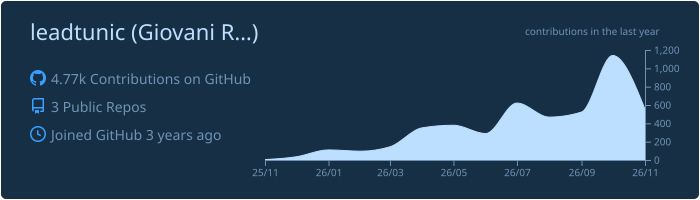

## About me

Full Stack developer building complete products, from architecture and APIs to infrastructure and production. I work with **AI agents, SaaS platforms, automation and cloud**, and I like solving operational problems end to end, not building isolated demos.

##  Benedash

**Social media hub + automation platform**

Manage social channels, automations, conversations and AI workflows in one place, through official integrations.

## Open source

<table>
<tr>
<td width="50%" valign="top">

###  [AgentDock OS](https://github.com/leadtunic/Agentdock-os)

Self-hosted control plane for **governed AI agents**, with approvals, audit logs and cost policies.

</td>
<td width="50%" valign="top">

###  [Agent SkillForge](https://github.com/leadtunic/Skillforge)

**50 reusable AI agent skills** for engineering, QA, security and DevOps.

</td>
</tr>
</table>

## Tech stack

**Frontend**  

**Backend**  

**Data**  

**AI**  

**Cloud & DevOps**  

## GitHub activity

<picture>
  <source media="(prefers-color-scheme: dark)" srcset="https://raw.githubusercontent.com/leadtunic/leadtunic/output/github-snake-dark.svg" />
  <source media="(prefers-color-scheme: light)" srcset="https://raw.githubusercontent.com/leadtunic/leadtunic/output/github-snake.svg" />
  
</picture>

